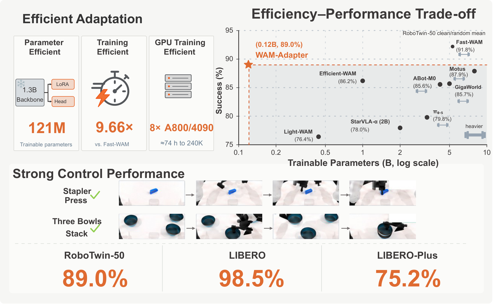
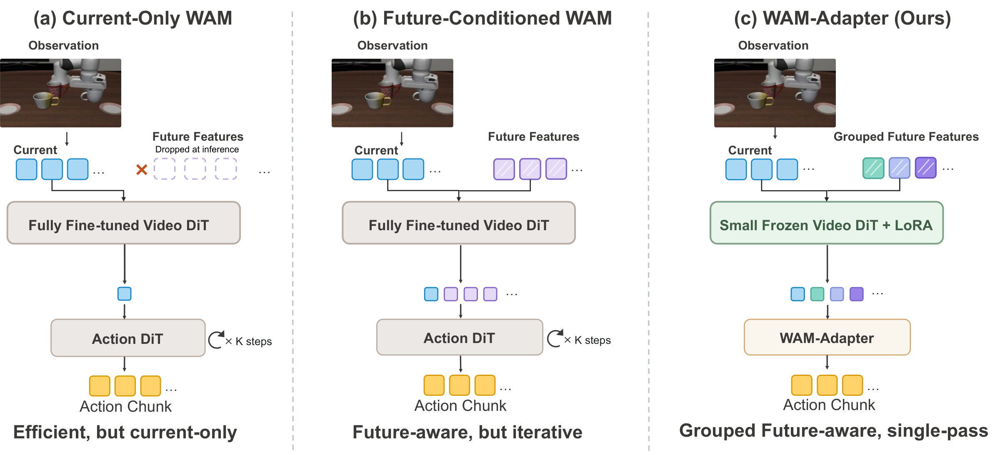
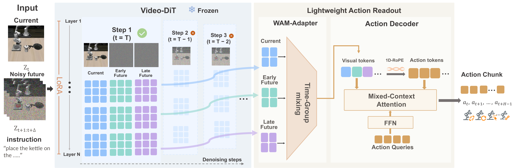
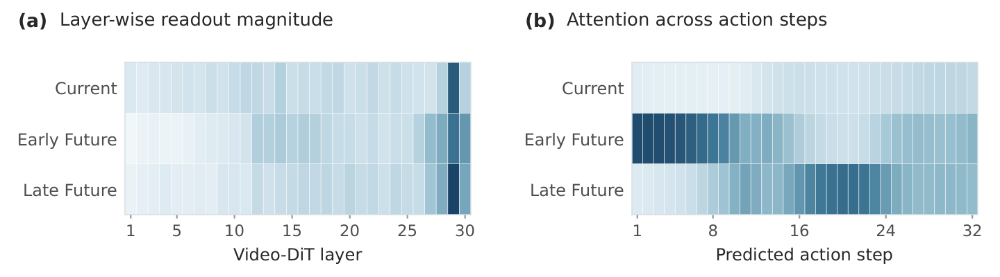
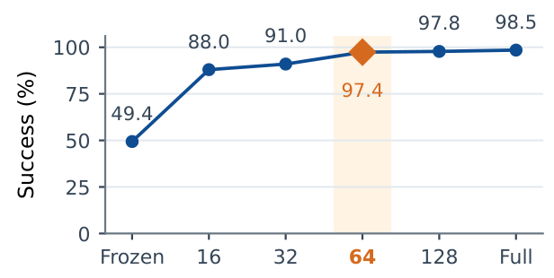

<div align="center">

<h1>WAM-Adapter</h1>
<h3>Efficiently Adapting Video-DiT World Representations to Robot Actions</h3>

<p>
  <a href="https://arxiv.org/abs/XXXX.XXXXX"></a>
  <a href="https://ldx825.github.io/WAM-Adapter-Homepage/"></a>
  <a href="https://huggingface.co/ldx825/WAM-Adapter"></a>
  <a href="https://github.com/ldx825/WAM-Adapter"></a>
  <a href="LICENSE"></a>
</p>

<p>
  <strong>Dongxu Liu</strong><sup>1,2,*</sup>&emsp;
  <strong>Zhe Li</strong><sup>1,*</sup>&emsp;
  <strong>Zundong Ke</strong><sup>1</sup>&emsp;
  <strong>Zhipeng Zhang</strong><sup>1,†</sup>
</p>

<p>
  <sup>1</sup>AutoLab, School of Artificial Intelligence, Shanghai Jiao Tong University<br>
  <sup>2</sup>Awaken Robotics<br>
  <sup>*</sup>Equal contribution&emsp;&emsp;<sup>†</sup>Corresponding author
</p>

<p>
  
</p>

<p>
  <em>WAM-Adapter freezes a compact 1.3B Video-DiT, adapts it with LoRA, and directly reuses the
  multi-layer representations produced by a single current+future forward pass for lightweight
  action-chunk prediction.</em>
</p>

<p>
  If this repository is useful for your research, please consider giving it a ⭐.
</p>

</div>

---

## 📘 Contents

- [News](#-news)
- [Overview](#-overview)
- [Method](#-method)
- [Results](#-results)
- [Quick Start](#-quick-start)
  - [Installation](#installation)
  - [Model assets](#model-assets)
  - [Data and caches](#data-and-caches)
  - [Training](#training)
  - [RoboTwin evaluation](#robotwin-evaluation)
  - [Real-robot deployment](#real-robot-deployment)
- [Configuration](#-configuration)
- [Repository Layout](#-repository-layout)
- [Citation](#-citation)
- [Acknowledgements](#-acknowledgements)
- [License](#-license)

---

## 📰 News

- **2026-10**: Complete training / evaluation code and the RoboTwin 2.0 pipeline are released.
- **2026-10**: Pretrained checkpoints for RoboTwin 2.0 and all four LIBERO suites are released on
  [Hugging Face](https://huggingface.co/ldx825/WAM-Adapter); the
  [project page](https://ldx825.github.io/WAM-Adapter-Homepage/) is live.
- **Coming soon**: arXiv paper.

---

## 🔍 Overview

<p align="center">
  
</p>

**Abstract.** Pretrained Video Diffusion Transformers encode rich spatiotemporal priors from
large-scale videos, making them promising backbones for robot control. However, efficiently adapting
them into World Action Models remains challenging. Existing approaches reduce video-adaptation or
action-prediction costs, but it remains unclear whether representations produced during future-video
adaptation can directly support lightweight action prediction. To address this gap, we propose
WAM-Adapter, a parameter- and training-efficient framework that freezes the Video-DiT backbone,
adapts it with LoRA, and reuses multi-layer representations for action prediction. A lightweight
readout organizes multi-layer K/V representations from current-and-future processing into Current,
Early-Future, and Late-Future groups, applying group-specific cross-layer fusion for action-chunk
prediction. Inference requires a single Video-DiT forward over the current observation and noisy
future slots, without future-video generation or iterative action denoising. Without embodied
pretraining, WAM-Adapter uses only 121M trainable parameters with a compact Wan-1.3B backbone,
achieving 89.0% success across 50 RoboTwin 2.0 tasks, 98.5% on LIBERO, and 75.17% on LIBERO-Plus. To
our knowledge, this is the smallest reported trainable-parameter budget for directly trained WAMs
without embodied pretraining. Under the same setting, WAM-Adapter improves training throughput by
9.66× while using 98% fewer trainable parameters than Fast-WAM. These results show that Video-DiT
representations formed during world-model adaptation can be efficiently reused for strong robot
control.

---

## 🧠 Method

Three design decisions keep both **adaptation** and **action readout** lightweight:

1. **Frozen Video-DiT + LoRA.** The pretrained `Wan2.1-T2V-1.3B` backbone stays frozen; LoRA
   (rank 64) adapts it to robot data, so no full backbone fine-tuning is needed.
2. **One joint current+future pass.** The clean current frame and a few noisy future latent slots
   (τ = 1) are processed in a *single* Video-DiT forward. No future-video denoising loop, no extra
   action-side Video-DiT forward.
3. **Temporal-group cross-layer readout.** The readout preserves the resulting **Current /
   Early-Future / Late-Future** representations, learns *group-specific* cross-layer fusion weights,
   aligns fused keys to the action timeline (physical action-step 1-D RoPE), and predicts the whole
   action chunk with a small mixed-context action decoder (one action query per action step).

Setting `num_future_slots = 0` turns the same code into the current-frame-only control.

<p align="center">
  
</p>

---

## 📊 Results

WAM-Adapter achieves strong control performance with the **smallest trainable-parameter budget**
among directly trained WAMs without embodied pretraining:

| Benchmark | WAM-Adapter |
|---|---|
| RoboTwin 2.0 (50 tasks, clean/randomized mean) | **89.0 %** |
| LIBERO (four suites) | **98.5 %** |
| LIBERO-Plus (zero-shot, 7 distribution shifts) | **75.17 %** |

Efficiency (same setting):

| Metric | WAM-Adapter |
|---|---|
| Trainable parameters | **121.0 M** (1.3B frozen backbone) |
| Training throughput | **9.66×** that of Fast-WAM |
| Peak training memory | **24.52 GiB** |
| Inference latency (RTX 4090) | **92.05 ms** per query |
| Peak inference memory | **3.41 GiB** |

Full comparison tables and ablations (temporal groups, cross-layer fusion, all-layer readout, LoRA
rank sweep) will be included with the arXiv release.

<p align="center">
  
</p>

<p align="center">
  
</p>

---

## ⚡ Quick Start

### Installation

```bash
git clone git@github.com:ldx825/WAM-Adapter.git
cd WAM-Adapter
pip install -e .      # CUDA environment with torch==2.7.1+cu128 (see pyproject.toml)
```

Requirements: Python ≥ 3.10, a CUDA-capable GPU for training/evaluation.

### Model assets

Pretrained WAM-Adapter checkpoints are hosted on
[Hugging Face](https://huggingface.co/ldx825/WAM-Adapter):

| File | Benchmark | Steps |
|---|---|---|
| `wam_adapter_robotwin50_240k.pt` | RoboTwin 2.0 (50 tasks) | 240k |
| `wam_adapter_libero_spatial_70k.pt` | LIBERO-Spatial | 70k |
| `wam_adapter_libero_object_60k.pt` | LIBERO-Object | 60k |
| `wam_adapter_libero_goal_80k.pt` | LIBERO-Goal | 80k |
| `wam_adapter_libero_long_80k.pt` | LIBERO-Long | 80k |

```bash
# Example: download the RoboTwin 2.0 checkpoint
huggingface-cli download ldx825/WAM-Adapter wam_adapter_robotwin50_240k.pt
```

The Video-DiT backbone is [`Wan-AI/Wan2.1-T2V-1.3B`](https://huggingface.co/Wan-AI/Wan2.1-T2V-1.3B).
Download `Wan2.1-T2V-1.3B` locally and point the loader at it (DiffSynth model manager):

```bash
export DIFFSYNTH_MODEL_BASE_PATH=/path/to/models    # parent dir containing Wan2.1-T2V-1.3B
export DIFFSYNTH_SKIP_DOWNLOAD=true                 # always use the local copy
```

### Data and caches

Training consumes precomputed **factor-2 video-latent** and **umT5 text-embedding** caches. The
builder validates the RoboTwin 2.0 dataset, text cache and latent cache at every step and can be
re-run safely (it skips completed episodes):

```bash
DATASET_DIR=/path/to/robotwin2.0 \
LATENT_CACHE_DIR=./data/latent_cache/robotwin50_3cam384_factor2 \
TEXT_EMBED_CACHE_DIR=./data/text_embeds_cache/robotwin \
VIDEO_MODEL_PATH=./data/models/Wan2.1-T2V-1.3B \
NORM_STATS=/path/to/robotwin2.0/dataset_stats.json \
bash scripts/precompute_wam_adapter_robotwin_full.sh
```

### Training

The 50-task RoboTwin 2.0 recipe (8 GPUs, global batch 128, 500k steps, LoRA r64 + temporal-group
readout) is a single script:

```bash
GPU_IDS=0,1,2,3,4,5,6,7 \
DATASET_DIR=/path/to/robotwin2.0 \
MODEL_PATH=./data/models/Wan2.1-T2V-1.3B \
NORM_STATS=/path/to/robotwin2.0/dataset_stats.json \
bash scripts/train_wam_adapter_robotwin_full_500k.sh
```

Training supports **exact segmented resume** (optimizer / scheduler / RNG / loader state) via
`RESUME=<checkpoint>`; see `scripts/run_wam_adapter_robotwin_full_pipeline.sh` for the end-to-end
precompute → train → evaluate driver.

### RoboTwin evaluation

```bash
CKPT=runs/<run>/checkpoints/weights/step_500000.pt \
GPU_ID=0 \
bash scripts/eval_robotwin.sh
```

The evaluator shards the 50 RoboTwin tasks across GPUs and reports per-task clean / randomized
success rates. A resumable task queue is available through `scripts/run_robotwin50_eval_trials50.sh`.

### Real-robot deployment

`experiments/real_robot/` contains the HDF5 data preparation, training, serving and querying
tooling for physical robots:

```bash
# serve a trained policy over websocket
CKPT=runs/<run>/checkpoints/weights/step_500000.pt \
bash experiments/real_robot/serve_real_robot_policy.sh
```

The RoboTwin rollout integration lives in `experiments/robotwin/wam_adapter_policy/` with the
manager in `experiments/robotwin/run_robotwin_manager.py`.

---

## ⚙️ Configuration

The model is configured through `configs/model/wam_adapter.yaml` plus the `action_decoder_config`
overrides used by the training scripts:

| Key | Meaning | Value in the 50-task run |
|---|---|---|
| `num_future_slots` | Noisy future latent slots after the current frame (0 = current-only ablation) | `2` |
| `readout_layer_indices` | Backbone layers contributing to the readout | all 30 blocks |
| `temporal_position_stride` | Physical action-step stride per latent frame (action-time alignment) | `16` |
| `group_positions` | Physical time of the Current / Early / Late groups | `[0, 16, 32]` |
| `share_temporal_group_layer_weights` | Share one cross-layer mixture across temporal groups | `false` |
| `action_decoder_layers` | Mixed-context action blocks | `2` |
| `readout_gradient_checkpointing` | Recompute the capture region to save memory | `false` |
| `cached_latent_spatial_downsample_factor` | Spatial compression of the precomputed latent cache | `2` |

More details (backbone shapes, frozen/trainable split, forward paths, checkpoint format) are in
[`docs/architecture.md`](docs/architecture.md).

---

## 🗂️ Repository Layout

```text
WAM-Adapter/
├── src/wam_adapter/                    # Python package
│   ├── models/wan22/
│   │   ├── wam_adapter.py              # the model (single nn.Module, full train/infer path)
│   │   ├── wam_adapter_readout.py      # temporal-group cross-layer readout + action decoder
│   │   ├── wan_video_dit.py            # Wan Video-DiT backbone (frozen, LoRA-adapted)
│   │   ├── wan_video_text_encoder.py   # umT5 text encoder / tokenizer
│   │   ├── wan_video_vae.py            # VAE
│   │   └── action_dit.py  mot.py  helpers/  schedulers/
│   ├── datasets/                       # LeRobot / HDF5 video datasets + processors
│   └── utils/
├── configs/
│   ├── model/wam_adapter.yaml          # model configuration
│   ├── data/{robotwin.yaml, real_robot_hdf5.yaml}
│   ├── task/{robotwin_uncond_3cam_384_1e-4.yaml, real_robot_hdf5_3cam_384_1e-4.yaml}
│   ├── robotwin_subsets/*.json         # task/episode manifests
│   └── sim_robotwin.yaml               # RoboTwin rollout environment config
├── scripts/                            # precompute / train / evaluate entry points
├── experiments/
│   ├── robotwin/                       # rollout manager + policy integration
│   └── real_robot/                     # HDF5 prep, training, serving, querying
├── tests/                              # unit tests for the model and LoRA utilities
└── docs/architecture.md
```

---

## 📝 Citation

The arXiv release is coming soon; for now please cite the project as:

```bibtex
@article{wamadapter2026,
  title   = {WAM-Adapter: Efficiently Adapting Video-DiT World Representations to Robot Actions},
  author  = {Liu, Dongxu and Li, Zhe and Ke, Zundong and Zhang, Zhipeng},
  journal = {arXiv preprint},
  year    = {2026},
}
```

---

## 🙏 Acknowledgements

We thank the [Wan](https://huggingface.co/Wan-AI) team for releasing the pretrained Video-DiT and
text-encoder assets, the [DiffSynth-Studio](https://github.com/modelscope/DiffSynth-Studio) project
for the Wan model-loading utilities, and the [RoboTwin 2.0](https://robotwin-platform.github.io/)
team for the simulation benchmark.

---

## ⚖️ License

This repository is released under the **MIT License**. Pretrained model assets, datasets and
benchmark implementations remain subject to their own licenses and terms of use.
